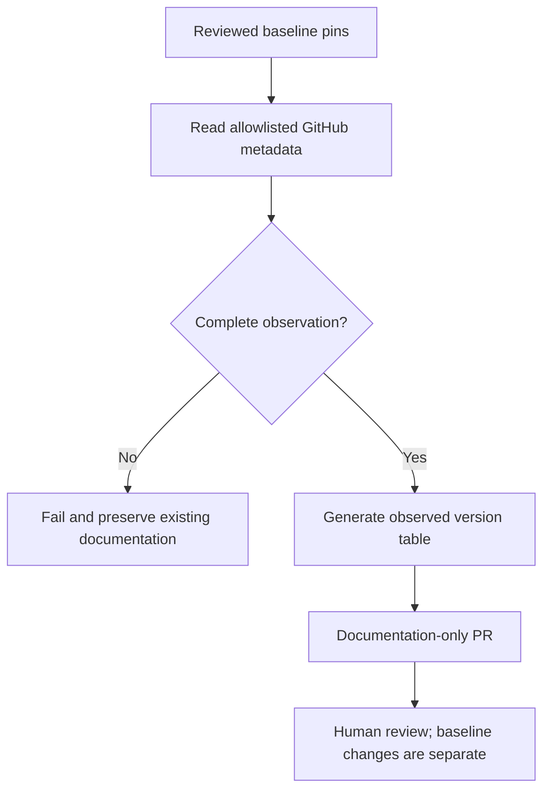

# Component versions and observation policy

`components.json` is a reviewed baseline inventory, not a compatible product
distribution or deployed-version registry. Its `baselineVersion` versions the
inventory independently of component packages, diagnostic rubrics and releases.
Every component has an exact Git commit. No version file means commit-identified,
not version zero. Organizational scoring remains outside this manifest.



The observer reads main's commit, then version files at that commit, and queries
the latest published GitHub release separately. A package declaration does not
prove npm/PyPI publication; a tag/release does not prove deployment.
It never executes retrieved code, updates baseline pins, assesses compatibility
or writes component repositories.

## Commands

```sh
node scripts/ecosystem-observe.js
node --test test/ecosystem.test.js
node scripts/ecosystem-observe.js --live
```

The first two are offline. Live mode uses bounded responses, timeouts and only
the fixed GitHub API host. An optional `GH_TOKEN` stays in the process environment.
Any component error fails the run; incomplete observations do not replace docs.
Version sources are explicitly allowlisted in code and manifest.

The `Ecosystem observations` Action validates on PRs and main. Scheduled runs
(06:15 UTC daily) and manual dispatch from main may open a PR changing only
`observations.md`. Existing open proposals are left for review, not duplicated.
It requires GitHub's setting permitting Actions to create PRs. No auto-merge,
cross-repository write credential, source modification or deployment is enabled.
If unavailable, ask the owner; do not add a broader PAT or weaken protections.

Generated documentation has no daily timestamp, avoiding daily churn when
facts do not change. Git and Actions history retain run/publication times.
Checked-in observations can be stale and are not a live dashboard.

## Approval boundaries

| Change | Review |
| --- | --- |
| Refresh observed metadata | Review generated PR; no compatibility approval |
| Change baseline pin or source | Owner reviews scoped evidence and baseline delta |
| Change governance or agent navigation | Explicit code-owner review |
| Release component | Component's own release process |
| Execute or deploy | Separate Runtime/CI permission and approval |

Baseline pins may intentionally lag main. SPECTRA's self-pin points to a prior
commit: a manifest cannot contain the final hash of its own introducing commit.
This baseline remains NOT_VERIFIED. An integration evaluation would require a
separately approved protocol before any compatibility claim can be introduced.
