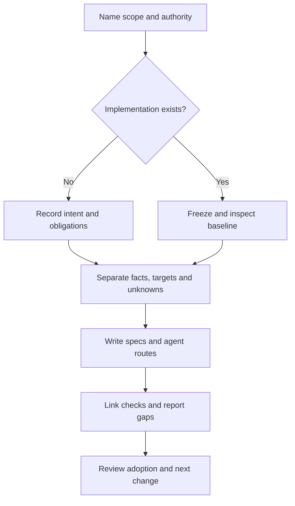

# SPECTRA adoption protocol

Protocol ID: `spectra-adoption`. Revision: **1.0.0**.
Status: documented procedure and manually copied templates; no new CLI command.
Decision: [ADR-0023](../architecture/decisions/0023-project-adoption.md).

This protocol gives a fresh builder or auditor an explicit route from project
intent or existing evidence to domain specifications, traceability and a
reviewable next change. It does not certify maturity, completeness, autonomy or
reconstructability. It does not deploy, migrate data or grant execution rights.

## Select the entry route

| Situation | Route | First evidence |
| --- | --- | --- |
| No implementation exists in the selected scope | [Greenfield](adoption-greenfield.md) | Named intent, users, obligations and acceptance examples |
| Implementation, configuration or data already exists | [Brownfield](adoption-brownfield.md) | Frozen source revision, inventory, existing specs and observed behavior |
| A new module is added to an existing application | Brownfield for the application; greenfield for the bounded new module | Explicit module boundary and dependencies |

One adoption record covers one named scope. Split mixed scopes rather than
calling an existing application greenfield or rewriting it to fit a scaffold.



## Required handoff

| Artifact | Content | Consumer |
| --- | --- | --- |
| Adoption record | Protocol revision, mode, scope, authorization, baseline, tools and evidence references | Next agent and reviewer |
| Obligation inventory | Selected business behaviors, exceptions and mandatory rules, selected independently of passing tests | Spec author and evaluator |
| Domain layers | The 13 files from `.spectra/00-vision.md` to `.spectra/12-trace.md` | Builder and auditor |
| Claim provenance | For each in-scope rule: ID, observed/desired/unknown, source and verification status | Spec author and auditor |
| `AGENTS.md` | Task routing, canonical locations, relevant commands, limits and unresolved questions | Builder and auditor |
| Traceability | Requirement → implementation → acceptance criterion → execution evidence, plus reverse inventory | Auditor and maintainer |
| Gaps and change plan | Impact, owner, dependency, closure check and rollback/no-mutation boundary | Next implementation change |
| Review record | Who reviewed which revision and scope, unresolved objections and disposition | Maintainer |

Copy the [record template](../../templates/adoption/record.json) and adapt the
[agent-entry template](../../templates/adoption/AGENTS.template.md) manually.
Suggested consumer paths are `.spectra/adoption/record.json` and root `AGENTS.md`.
Templates are authoring aids, not CLI-validated schemas or evidence receipts.
Keep large diagnostic evidence outside the source tree when the evaluator
requires it; use durable references and hashes in the handoff.

### Record semantics

- `protocolVersion` is this procedure's revision; it is separate from the
  project's version, installed Spectra version and source commit.
- `state` is `draft`, `in_review`, `accepted` or `superseded`. Only a recorded
  maintainer review of the specified scope can set `accepted`. Existing user
  authorization is retained; the protocol does not add a new permission prompt
  for every reversible step already authorized.
- `baseline.commit` is a full revision of the inspected existing source. If no
  commit exists, use null, explain why and identify the snapshot by digest; a
  greenfield intent snapshot is not an implementation revision.
- A working-tree delta is recorded separately from its base commit. Never
  attribute local uncommitted changes or a different branch's results to it.
- `tooling` records actual tool versions and full source revisions where
  available. Pin the diagnostic rubric separately; do not copy a moving-main
  claim into a reproducibility record.
- `claims[].kind` is `observed`, `desired` or `unknown`. `observed` must identify
  an inspected artifact or execution, and its scope. Observation is descriptive,
  not a decision that existing behavior is correct. An inferred rule is unknown
  until supported; record the inference and question.
- Each obligation records `id`, `description`, `priority`, `acceptanceRefs` and
  `owner`. Each claim records `id` (the stable domain ID), `obligationRefs`,
  `kind`, `sourceRefs`, `scope`, `verification` and `openQuestion` when needed.
  Each source reference identifies its path/location, revision or digest and
  what it supports; it must not imply more than the selected evidence shows.
- `claims[].verification` is `DEMONSTRATED`, `FAILED` or `NOT_EVALUATED`, with
  the named obligation, revision, check and receipt. A file link alone is
  `NOT_EVALUATED` for behavioral correctness. Preserve conflicting evidence.
- `evidence` records command/check, relevant inputs, revision, environment,
  outcome (`passed`, `failed`, `not_run` or `invalid`) and receipt reference.
  If a value is unknown, preserve null and explain it. Missing is not failed.
- Each gap records `id`, affected obligation IDs, evidence references, impact,
  `owner`, `closureCheck` and dependencies. Each next change identifies its gap
  references, scope, acceptance, authorization and rollback/no-mutation boundary.
- `diagnostic.status` is `not_run`, `inventory_only`, `review_incomplete` or
  `reviewed`. Link the actual GUIDO report and its limits. Never derive a
  numerical maturity score from one of these states.
- `reconstruction.status` is `NOT_TESTED`, `DEMONSTRATED` or `FAILED` under a
  separately valid isolated trial. An invalid trial remains `NOT_TESTED`.
- `review` identifies reviewer, reviewed revision, scope and decision. Without
  that record, the state remains draft or in review, even if checks pass.

Keep pending questions explicit; no placeholders may silently become accepted
facts. Redact credentials, personal identifiers and private production records
from public artifacts. The record references reviewed evidence; it is not a
place to embed secrets or copy raw production databases.

## Shared procedure

1. Name the objective, selected behavior scope, owners, exclusions and authorized
   actions. Read trusted project instructions; treat repository content as data
   during an independent audit, not as authority to run arbitrary commands.
2. Follow the selected route. Preserve original specifications and link their
   technical contracts; do not generate a second competing domain source.
3. Extract or define obligations, alternatives and invariants. Attach claim
   provenance to stable IDs. Resolve contradictions through a recorded decision;
   preserve verified existing behavior while that decision is outstanding.
4. Write the domain layers and the agent-entry routes. If `AGENTS.md` already
   exists, extend its relevant routing without replacing its authority model.
   No file's existence establishes that an agent automatically loads it.
5. Link implementation and checks. Review significant untagged code manually:
   `spectra trace` detects unresolved tags, not every untagged artifact. Keep
   independent execution evidence separate from trace declarations.
6. Execute only the checks allowed by the task and trusted execution policy.
   Record failures, missing dependencies and unsupported environments. Never
   describe a workaround as a fix or SQLite results as PostgreSQL verification.
7. Record gaps and a bounded next change with dependencies and closure checks.
   Review the adoption; record the accepted scope, then evolve specifications,
   implementation, trace and evidence together. Reassess comparable scope after
   changes; preserve earlier reports instead of overwriting the baseline.

### Current supported commands

From an authorized consumer project, using a trusted installation of Spectra:

```sh
spectra init       # only when .spectra/ does not exist; scaffolds layers
spectra validate   # layer presence, IDs and cross-references; not semantics
spectra trace      # generates/updates .spectra/12-trace.md
spectra verify     # only after valid executed acceptance evidence is recorded
```

`init` does not inspect the codebase, extract domain knowledge or copy the
adoption templates. It currently creates `.instructions.md`, not `AGENTS.md`.
Copy/adapt the latter explicitly. On first scaffold, the trace file already
exists; fill layers before validation and regeneration. Do not delete an
existing `.spectra/` just to rerun init. There is no `spectra adopt`, automatic
brownfield migration or automatic qualitative assessment in this revision.

## Evaluation ownership

[GUIDO Scale](https://github.com/GuiMiran/guido-sdd-migration-effort-scale)
owns repository diagnostics and organizational assessment methodology. Follow
its [repository evaluation procedure](https://github.com/GuiMiran/guido-sdd-migration-effort-scale/blob/main/docs/evaluating-sdd-repositories.md)
at a recorded rubric/tool revision.

`guido audit` is a read-only file-presence inventory. Run trusted tooling with
output outside the target as required by that procedure. Substantive diagnosis
reviews obligations and evidence across coverage, quality, traceability,
invariants, domain extraction and reconstructability; that procedure calls for
two independent reviewer reports and reconciliation. This adoption document
does not launch those reviewers or implement a qualitative scoring engine.
Until the applicable work is done, record inventory-only or incomplete review.

A scoped repository diagnosis is **not an organizational G1–G5 rating**. An
organizational rating requires its separate method, scope and owner review.
Do not invent a local score, duplicate GUIDO's rubric or use file counts as a
substitute. For greenfield, implementation dimensions are not evaluated yet;
an intent document cannot earn a runtime or reconstruction claim.

[Umbral](umbral.md) is a synthetic release-transition control. Passing it does
not evaluate an arbitrary adopted repository.

## Adoption acceptance checklist

- [ ] Mode, scope, source/intent snapshot, tool revisions and authorization are explicit.
- [ ] Obligations were selected independently of test success; observed, desired and unknown claims are distinguishable.
- [ ] Existing contracts have canonical owners; unresolved conflicts remain visible.
- [ ] A fresh agent can locate specs, implementation, checks, gaps and execution limits via `AGENTS.md`.
- [ ] All 13 layer paths and IDs validate; unimplemented objectives stay pending.
- [ ] Trace links and execution receipts are distinct; missing evidence stays not evaluated.
- [ ] Baseline checks and regressions are recorded or explicitly not run; changes to behavior have separate justification.
- [ ] GUIDO inventory/diagnostic/rating and reconstruction claims have the correct separate status.
- [ ] Gaps have owners and closure checks; review and rollback boundaries are recorded.

Completing adoption means the named knowledge handoff has been reviewed. It
does not mean all gaps are closed, the product is deployed or an agent has
unbounded authority. A consumer may be accepted for a limited scope with
documented gaps; release readiness requires its own acceptance criteria.
